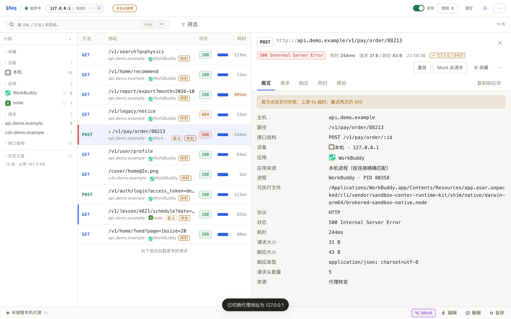
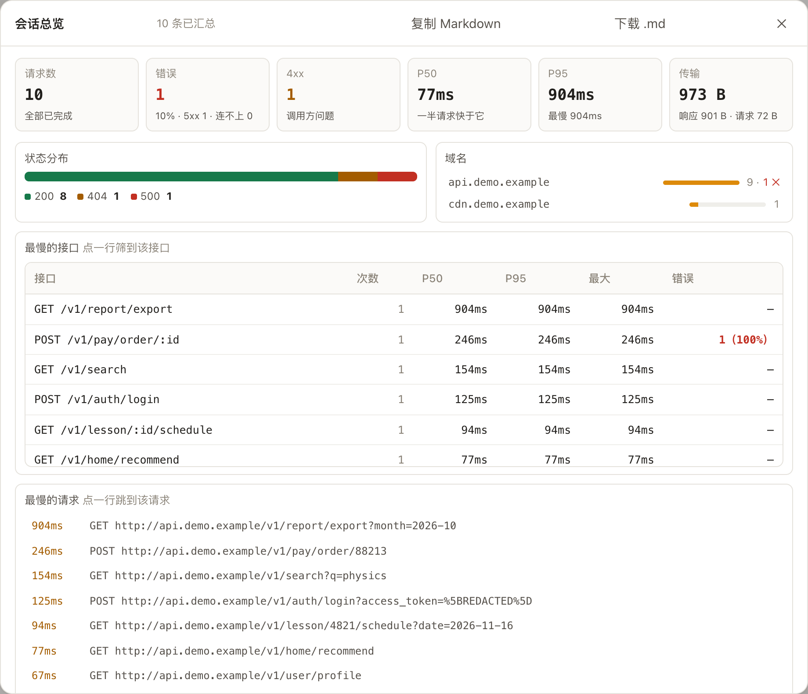
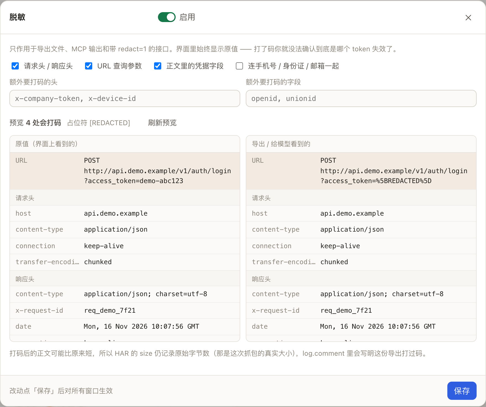
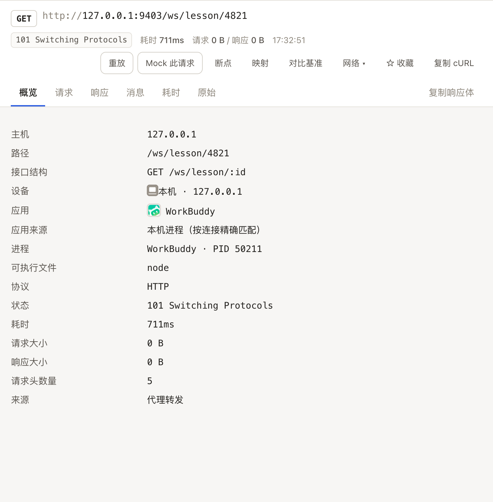
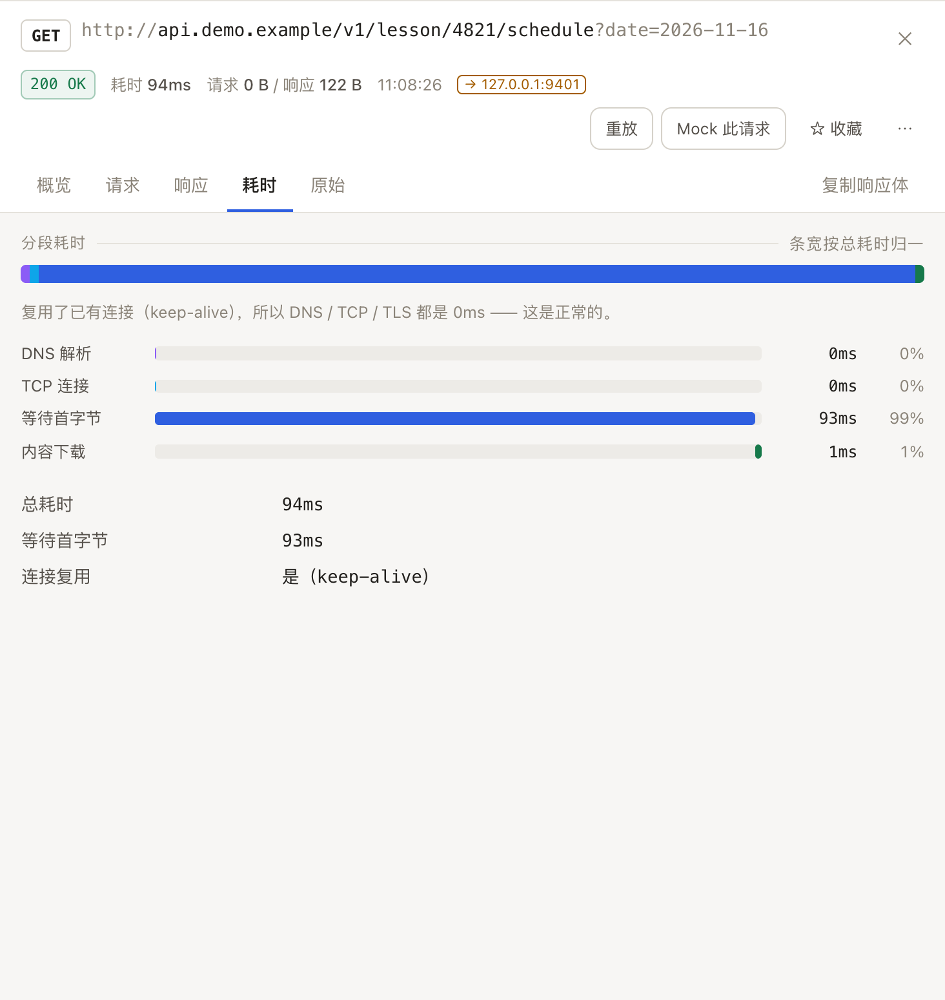
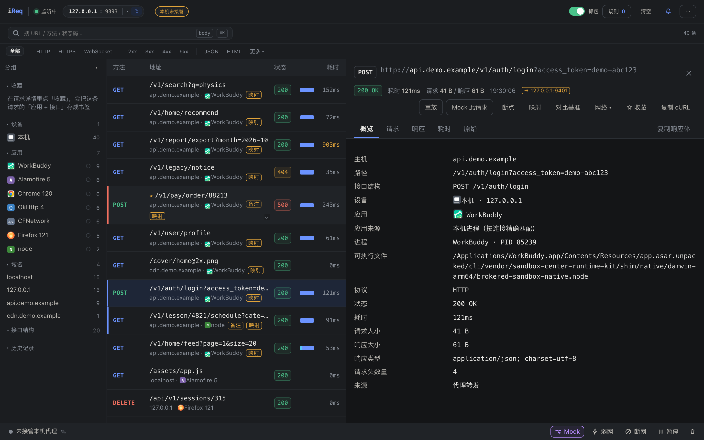

[简体中文](README.zh-CN.md) | **English**

# iReq

[](https://github.com/myafer/iReq/releases) [](https://github.com/myafer/iReq/issues) [](LICENSE)

HTTP(S) capture / Mock / replay in one window. Point a phone or your machine at it and every request shows up in the browser — no native dependencies, macOS / Windows / Linux.

## Download

| Platform | File |
| --- | --- |
| macOS (Apple Silicon / Intel) | `iReq-*-arm64.dmg` · `iReq-*-x64.dmg` |
| Windows | `iReq-Setup-*.exe` (installer) · `iReq-Portable-*.exe` |
| Linux | `iReq-*.AppImage` |
| CLI only (macOS / Linux / Windows) | `iReq-<os>-<arch>.tar.gz` · `iReq-win-x64.zip` |

Everything is under **[Releases › latest](https://github.com/myafer/iReq/releases/latest)**.

> The builds are **not code-signed**. On macOS the first launch says *"iReq is damaged"* — that's Gatekeeper, not a broken download. Drag it into Applications, then run once:
> `xattr -cr /Applications/iReq.app`. Windows (SmartScreen) and Linux show a similar "run anyway" prompt.

## Screenshots

<p align="center">
  
</p>

| Session overview (paste-able Markdown) | Redaction (mask before export) |
| --- | --- |
|  |  |
| **WebSocket messages** | **Timing breakdown** |
|  |  |

<details><summary>Dark theme</summary>

<p align="center"></p>

</details>

> Hostnames, tokens and order numbers in the shots are fake data from a demo script.

## What it does

| | |
| --- | --- |
| **Capture** | Plain HTTP and decrypted HTTPS with full headers and bodies; live list over SSE; filter by device / app / domain / endpoint |
| **Mock** | Method + URL (contains / wildcard / regex) + host → custom status, headers, body, delay |
| **Replay & diff** | Edit and resend; compare any two requests structurally (JSON path by path) |
| **Breakpoints** | Hold a request or response, edit it, release — or answer right away |
| **Scripts** | `onRequest` / `onResponse` / `onWebsocket` in a sandbox: add headers, rewrite bodies, drop heartbeats |
| **Domain mapping** | `api.example.com → 127.0.0.1:8080` without touching hosts or the client |
| **Reverse proxy** | Listen on a port for webhooks / callbacks and record them like any other traffic |
| **Network simulation** | Slow / offline / timeout, per app, host or IP |
| **Timing & performance** | DNS / TCP / TLS / TTFB / download per request; P50 / P95 / error rate per endpoint |
| **Overview report** | One page of conclusions plus copy / downloadable Markdown for the ticket |
| **Export** | HAR 1.2 or raw JSON with redaction on the way out; annotations travel with them |
| **AI / MCP** | Optional MCP server so an AI client can read traffic and change rules ([docs](docs/mcp.md)) |

Full capability list and trade-offs: [docs/feature-matrix.md](docs/feature-matrix.md) (Chinese).

## Quick start

**App** — grab it from [Releases](https://github.com/myafer/iReq/releases/latest), open, done. Proxy on `9090`, console on `http://127.0.0.1:9091`.

**CLI** — unzip, then `./ireq start` (same ports):

```bash
ireq start [-p 9090] [-u 9091] [-b 0.0.0.0] [-d ./data] [--no-persist]
ireq local on|off        # take over / release the system proxy (macOS)
ireq ca                  # print the root CA path
```

**Source** — `git clone` → `npm install` → `npm start` (one dependency: node-forge).

## Two things to set up

**1. Trust the root CA** — once, ever. It is pinned to `~/.ireq/ca/`, so upgrades and reinstalls never change it.

- **macOS**: ⋯ More → Certificate & connection → step 2 → *Install & trust now*, authorize once. The shield turns green.
- **iPhone**: Wi-Fi proxy → `<LAN-IP>:9090`, open `http://<LAN-IP>:9090/` in Safari, download the profile, then Settings → General → About → Certificate Trust Settings → turn on **iReq Root CA**. That last switch is the step everyone misses.
- **Android**: same page, then Settings → Security → Install a certificate → CA certificate. Android 7+ apps trust only system certs — use a debug build with `networkSecurityConfig`.
- **Windows / Linux**: `certutil -addstore -user Root reqlite-ca.pem` / `sudo cp … /usr/local/share/ca-certificates/ && sudo update-ca-certificates`.

**2. Point traffic at it**

- **Phone**: Wi-Fi proxy = the `LAN-IP:9090` from the top bar (not `127.0.0.1` — that points at the phone itself).
- **This machine**: ⋯ More → *Take over this machine* (or `ireq local on`). Your original proxy settings are restored when you release it.

## When it doesn't work

| Symptom | Fix |
| --- | --- |
| Chrome: "Your connection is not private" | Root CA isn't trusted yet — do step 1. |
| The list stays empty | Traffic isn't going through iReq: check the phone's Wi-Fi proxy, or that *Take over this machine* is on. |
| One domain keeps failing | It pins certificates or only speaks h2. iReq skips decryption for it automatically after two failures and keeps a row labelled *decryption skipped*. |
| Certificate error only inside one app | That app pins certificates — capture a debug build instead. |
| VPN drops after *Take over this machine* | The VPN client's own connection to its gateway is being intercepted. Add the gateway (e.g. `vpn.example.com`) and your internal ranges under *Take over this machine › Hosts / IPs that bypass the proxy*, then take over again. |

## Known limits

- Bodies up to 2MB each are persisted, so heavy traffic makes the JSONL grow fast (`--no-persist` opts out).
- Only port 443 is decrypted by default; add ports in Settings (MQTT / IMAP / binary protocols keep working as tunnels).
- WebSocket: last 200 frames per direction are kept; `permessage-deflate` frames are sized but not inflated.
- Phones carry no process information (UA inference or aliases only); local process detection is macOS-only.
- Scripts are synchronous with no network or file access, and request bodies can't be rewritten (that needs buffering uploads).

## Docs & feedback

[HTTP API + SSE](docs/api.md) · [MCP for AI clients](docs/mcp.md) · [Internals and release process](docs/development.md)

Bugs, wishes, "this feels awkward" — [open an issue](https://github.com/myafer/iReq/issues/new/choose), or **⋯ More → Feedback & ideas** inside the app. Please don't paste real tokens or cookies.

## License

MIT
