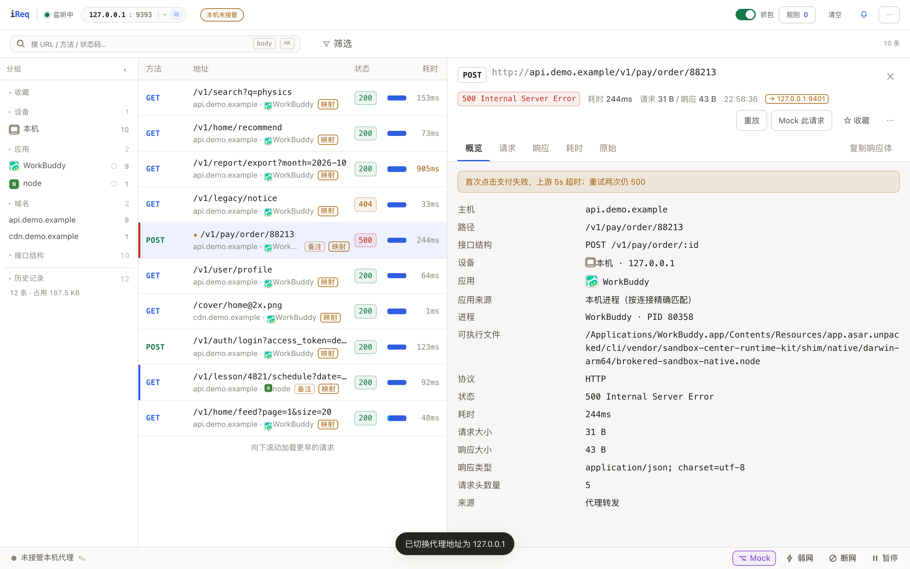
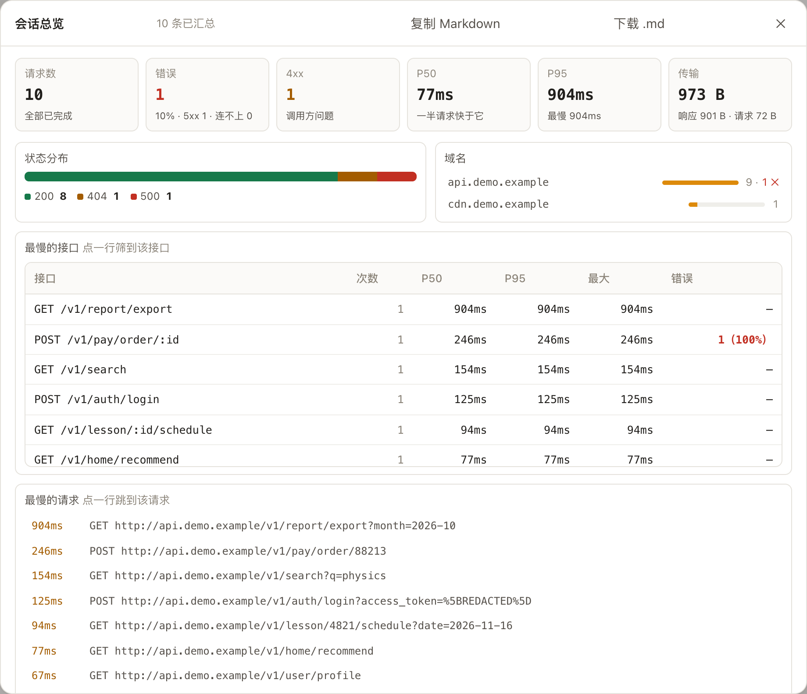
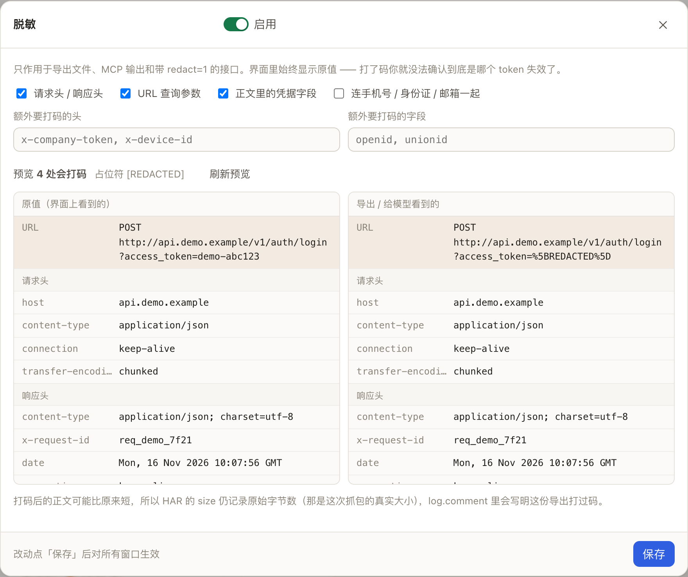
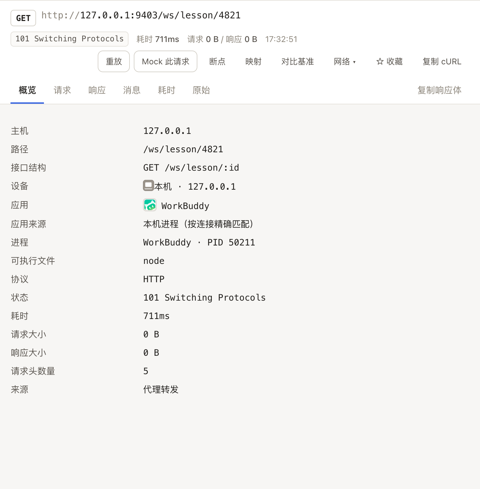
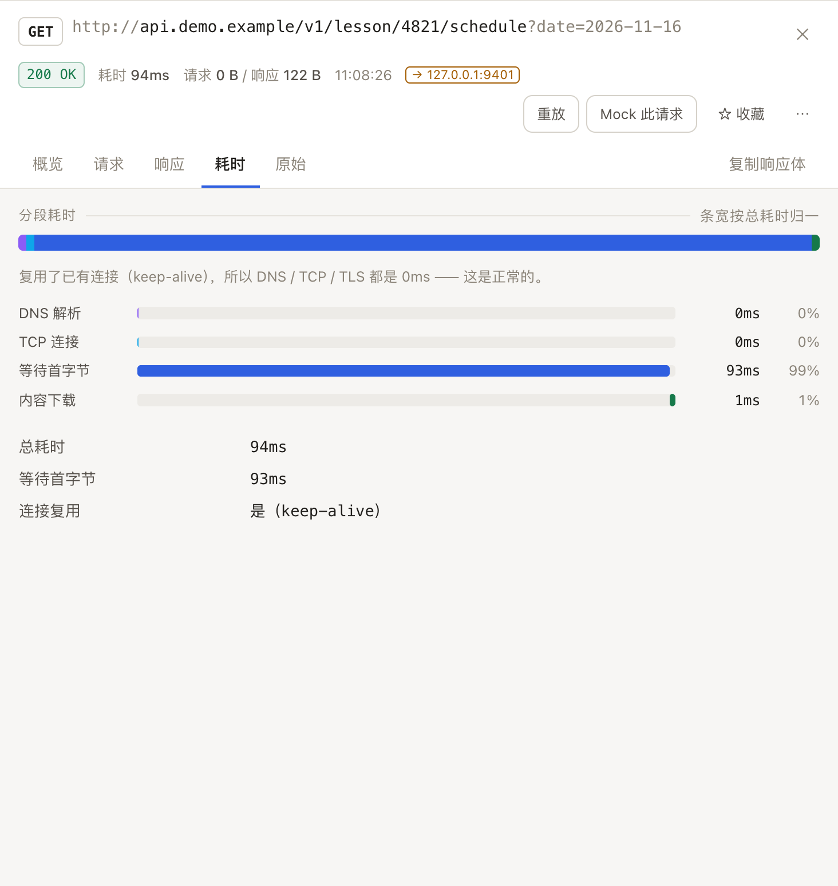
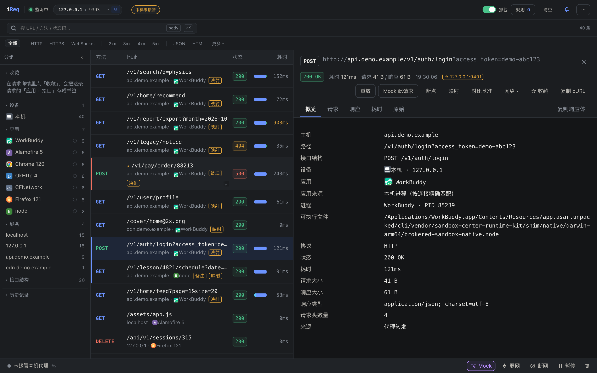

**简体中文** | [English](README.md)

# iReq

[](https://github.com/myafer/iReq/releases) [](https://github.com/myafer/iReq/issues) [](LICENSE)

一个窗口里把 HTTP(S) 抓包、Mock、重放全办了。让手机或本机的流量走它，所有请求就出现在浏览器里 —— 纯 Node 内核、无原生依赖，macOS / Windows / Linux 通用。

## 下载

| 平台 | 文件 |
| --- | --- |
| macOS（Apple Silicon / Intel） | `iReq-*-arm64.dmg` · `iReq-*-x64.dmg` |
| Windows | `iReq-Setup-*.exe`（安装版）· `iReq-Portable-*.exe`（免安装） |
| Linux | `iReq-*.AppImage` |
| 只要命令行（macOS / Linux / Windows） | `iReq-<os>-<arch>.tar.gz` · `iReq-win-x64.zip` |

都在 **[Releases › 最新版](https://github.com/myafer/iReq/releases/latest)**。

> 安装包**没有做代码签名**。macOS 首次打开会提示「“iReq”已损坏」—— 那是 Gatekeeper 拦的，不是包坏了。拖进「应用程序」后执行一次：
> `xattr -cr /Applications/iReq.app`。Windows（SmartScreen）和 Linux 遇到类似提示，选「仍要运行 / 允许」即可。

## 截图

<p align="center">
  
</p>

| 会话总览（结论可直接贴工单） | 脱敏（导出前打码） |
| --- | --- |
|  |  |
| **WebSocket 帧** | **耗时拆解** |
|  |  |

<details><summary>深色主题</summary>

<p align="center"></p>

</details>

> 截图里的域名、令牌、订单号都是演示脚本造的假数据。

## 能做什么

| | |
| --- | --- |
| **抓包** | 明文 HTTP 与解密后的 HTTPS，头与正文全在；SSE 实时进列表，按设备 / 应用 / 域名 / 接口筛 |
| **Mock** | 方法 + URL（包含 / 通配 / 正则）+ 域名 → 自定义状态码、头、正文、延迟 |
| **重放与对比** | 改完再发一次；任意两条请求按 JSON 路径逐字段对比 |
| **断点** | 把请求或响应挂住，改完放行，也可以直接返回、不打上游 |
| **脚本** | 沙箱里跑 `onRequest` / `onResponse` / `onWebsocket`：加头、改正文、丢心跳 |
| **域名映射** | `api.example.com → 127.0.0.1:8080`，不动 hosts、不动客户端 |
| **反向代理** | 开个端口收 webhook / 回调，转发并像普通流量一样记录 |
| **网络模拟** | 弱网 / 断网 / 超时，可按应用、域名、IP 分别下规则 |
| **耗时与性能** | 每条请求拆 DNS / TCP / TLS / 首字节 / 下载；按接口看 P50 / P95 / 错误率 |
| **会话总览** | 一页结论 + 可复制 / 下载的 Markdown，直接贴进工单 |
| **导出** | HAR 1.2 或原始 JSON，出口处顺带脱敏；标注跟着一起走 |
| **AI / MCP** | 可选把 iReq 当 MCP 服务，让 AI 客户端读流量、改规则（[怎么接](docs/mcp.zh-CN.md)） |

完整能力与取舍（缺什么、为什么不补）：[docs/feature-matrix.md](docs/feature-matrix.md)。

## 快速开始

**用安装包** —— 从 [Releases](https://github.com/myafer/iReq/releases/latest) 下载打开即可。代理 `9090`，控制台 `http://127.0.0.1:9091`。

**用命令行** —— 解压后 `./ireq start`（同样端口）：

```bash
ireq start [-p 9090] [-u 9091] [-b 0.0.0.0] [-d ./data] [--no-persist]
ireq local on|off        # 接管 / 释放本机系统代理（macOS）
ireq ca                  # 打印根证书路径
```

**跑源码** —— `git clone` → `npm install` → `npm start`（只有 node-forge 一个依赖）。

## 两件必须做的事

**1. 信任根证书** —— 一次就够。证书固定在 `~/.ireq/ca/`，升级、重装、换发行方式都不会变。

- **macOS**：更多 ⋯ →「证书与连接」第 2 步 →「一键安装并信任」，授权一次，盾牌变绿。
- **iPhone**：Wi-Fi 代理填 `<电脑局域网 IP>:9090`，Safari 打开 `http://<电脑局域网 IP>:9090/` 下载描述文件，再到 设置 → 通用 → 关于本机 → 证书信任设置 里打开 **iReq Root CA**。最后这一步最容易漏。
- **Android**：同一个页面下载证书，再到 设置 → 安全 → 安装证书 → CA 证书。Android 7+ 只信系统证书，抓自己的 App 要用带 `networkSecurityConfig` 的 Debug 包。
- **Windows / Linux**：`certutil -addstore -user Root reqlite-ca.pem` / `sudo cp … /usr/local/share/ca-certificates/ && sudo update-ca-certificates`。

**2. 让流量走它**

- **手机**：Wi-Fi 代理填顶栏显示的 `局域网IP:9090`（不是 `127.0.0.1`，那指向手机自己）。
- **本机**：更多 ⋯ →「接管本机」（或 `ireq local on`）。释放时会把原来的代理配置还原。
  不想抓全部流量的话，同一处可以选「只抓下面这些域名」：走系统 PAC，**列表外的域名直接连、完全不经过 iReq**。

## 出问题了

| 现象 | 处理 |
| --- | --- |
| Chrome 报「您的连接不是私密连接」 | 根证书还没信任 —— 回去做第 1 步。 |
| 列表一直是空的 | 流量没走 iReq：检查手机的 Wi-Fi 代理，或「接管本机」是不是开着。 |
| 某个域名一直失败 | 它做了证书固定或只认 h2。连续失败两次后 iReq 会自动跳过解密，并在列表里留一行标「跳过解密」。 |
| 只有某个 App 报证书错 | 那个 App 固定了证书 —— 换 Debug 包抓。 |
| 接管后要重启 App 才有流量 | 代理只对「新建连接」生效。App 里的 keep-alive / 长连接（HTTP/2、WebSocket、gRPC）不会因为系统代理变了就切过去，所以老连接还在直连。把 App 杀掉重开，或切一次飞行模式 / Wi-Fi 让连接重建即可（模拟器里的 App 同理）。 |
| 接管本机后 VPN 连不上 | VPN 客户端连自己网关的请求也被拦下来解密了。设置 › 接管本机 › 「不走代理的域名 / IP」里填上 VPN 网关（如 `vpn.example.com`）和内网网段，重新接管即可。 |

## 已知限制

- 正文最多每条 2MB 落盘，流量大时 JSONL 长得快（`--no-persist` 可关）。
- 默认只解密 443 端口，其它端口原样隧道（MQTT / IMAP / 私有协议不会被搞坏），需要的话在设置里加。
- WebSocket 帧每方向只留最近 200 条；`permessage-deflate` 压缩帧只记大小、不解压。
- 手机端拿不到进程信息，只能靠 UA 推断或别名；本机进程识别仅 macOS。
- 脚本是同步的，没有网络和文件；请求正文改不了（要缓冲整个上传）。

## 文档与反馈

[HTTP API + SSE](docs/api.zh-CN.md) · [MCP 接入](docs/mcp.zh-CN.md) · [开发、实现与发版流程](docs/development.zh-CN.md)

有 bug、有想法、或者用着别扭：[提个 issue](https://github.com/myafer/iReq/issues/new/choose)，应用内「更多 ⋯ → 反馈与建议」同一个入口。**别贴真实令牌和 Cookie。**

## License

MIT
